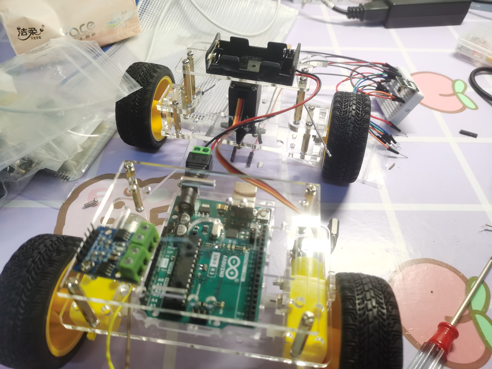
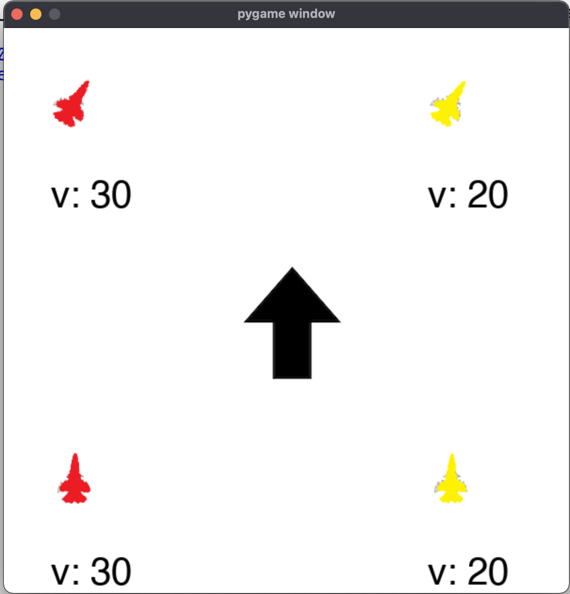

# EV Electronic Differential

**分布式驱动与电子差速 · Dual-Motor Distributed Drive and Electronic Differential**

[简体中文](#简体中文) · [English](#english)




---

## 简体中文

### 项目简介

本项目为上海大学中欧工程技术学院 2021–2022 年创新竞赛作品，围绕**双电机分布式驱动与电子差速**展开。项目用左右后轮独立驱动替代机械差速器，通过 Arduino 模型小车与 pygame 动画演示电子差速原理，并尝试用神经网络拟合差速与导向轮转角之间的关系。

### 项目内容

- 对比集中式驱动、轮毂电机分布驱动与双电机分布驱动方案；
- 用 pygame 制作四轮差速动画，展示转弯时内外轮的转速差异；
- 用 Arduino Uno、L298N、MG995 舵机与两个 TT 电机构建后驱模型小车；
- 完成竞赛论文、项目计划与制作总结；
- 提供基于 Keras 的回归网络示例，验证神经网络建模流程。

### 目录结构

```text
.
├── README.md
├── docs/
│   ├── paper.pdf / paper.pages      # 竞赛论文
│   ├── notes/                       # 红外遥控、舵机调试笔记
│   ├── presentation/                # 模型小车制作总结
│   └── project-plan/                # 立项与技术路线
├── src/
│   ├── arduino-car/                 # Arduino 模型小车源码
│   ├── motor-animation/             # pygame 动画 v1.0–v2.0
│   └── neural-network/              # Keras 回归示例
└── media/
    ├── car-photos/                  # 小车实物照片
    ├── paper-assets/                # 论文插图
    ├── references/                  # TI 毫米波传感器资料
    └── video-script/                # 演示视频脚本与素材
```

### 快速开始

#### 1. 电子差速动画（pygame）

```bash
cd src/motor-animation/v1.2
python -m pip install pygame
python motor.py
```

操作：`W` 加速，`A` / `D` 左转 / 右转；松开按键停车。四个车轮用颜色深浅表示转速，直观展示转弯时内外轮的差速。

四个版本的迭代关系：

- `v1.0`：四轮 + 速度颜色映射
- `v1.1`：增加方向指示
- `v1.2`：增加车轮转角
- `v2.0`：增加公路背景，车轮随转角旋转

> 脚本按相对路径加载图片，请先 `cd` 到对应版本目录再运行。

#### 2. 神经网络回归示例（Keras）

```bash
cd src/neural-network
pip install "tensorflow==2.12.*" "numpy<2"
python keras_test.py
```

脚本使用 Keras 内置的 Boston Housing 数据集做 4 折交叉验证，输出每折 MAE，用于验证回归网络的训练流程。该示例不是用实车差速数据训练的；论文中的「差速–转角」关系属于方案设计。

> 新版 Keras 3 已移除 `boston_housing` 数据集，因此需要 TensorFlow 2.12（Keras 2）。

#### 3. Arduino 模型小车

1. 用 Arduino IDE 打开 `src/arduino-car/motor2.1.ino`。
2. 安装库：`Servo`（内置）与 **IRremote 2.x**（代码使用 `IRrecv` / `decode_results` 旧 API，请勿直接安装 3.x）。
3. 选择 Arduino Uno 及对应串口，编译上传。
4. 串口监视器（9600）会打印红外键值；键值表见 `IRdecode.txt`。

### 硬件与接线

| 功能 | Arduino 引脚 |
| --- | --- |
| 左电机 A / B（L298N IN1 / IN2） | 5 / 6 |
| 右电机 A / B（L298N IN3 / IN4） | 9 / 10 |
| MG995 舵机信号 | 11 |
| HX1838 红外接收 OUT | 3 |

电源：2 节 18650 接 L298N 的 12V / GND，Arduino 与 L298N 共地；舵机建议单独 5V 供电，避免与电机抢电流导致抖动。

硬件清单：Arduino Uno、L298N 电机驱动模块、MG995 舵机、TT 直流电机 ×2、18650 锂电池 ×2、小车底盘、面包板、杜邦线。

### 工作原理

- 采用**双电机后驱 + 前轮舵机转向**：左右后轮各由一个直流电机独立驱动，取消机械差速器；
- 转弯时外侧车轮转速高于内侧车轮，控制器通过 L298N 调节左右电机的 PWM 占空比实现差速；
- pygame 动画把四个车轮的转速映射为颜色深浅，并用箭头和转角展示转向状态；
- Arduino 小车通过红外遥控接收指令，设置左右轮转速与舵机角度，完成前进、后退、左转与右转；
- Keras 示例用于验证回归网络的训练与评估流程，为后续用车辆数据拟合差速–转角关系提供基础。

### 文档

| 文件 | 内容 |
| --- | --- |
| `docs/paper.pdf` / `docs/paper.pages` | 竞赛论文《汽车分布式驱动与电子差速技术》 |
| `docs/project-plan/project-goals.pdf` | 项目目标与技术路线 |
| `docs/project-plan/electronic-differential-research.pdf` | 电子差速调研与公式推导 |
| `docs/presentation/car-build-summary.pptx` | 模型小车制作总结 |
| `docs/notes/ir-remote-notes.pages` | 红外遥控调试笔记 |
| `docs/notes/servo-notes.pages` | 舵机调试笔记 |
| `media/video-script/script.key` | 演示视频 Keynote 脚本 |

`.pages` / `.key` 为 Apple Pages / Keynote 源文件，需在 macOS 上打开；同名 PDF 可直接阅读。

### 已知限制

- 神经网络脚本是 Boston Housing 回归示例，只验证建模流程，未使用车辆数据；
- pygame 动画是原理演示，不是车辆动力学仿真；
- 模型小车为开环红外遥控，尚未实现基于差速算法的闭环控制；
- 项目完成于 2022 年初，代码保留原貌，未做现代化重构。

### 许可

本仓库用于学习与参考，未授予开源许可；如需复用代码或文档，请联系作者。

---

## English

### Overview

This is a 2021–2022 student innovation project from the Sino-European School of Technology, Shanghai University. It studies **dual-motor distributed drive and electronic differential**: two independently driven rear wheels replace the mechanical differential, with an Arduino model car and a pygame animation demonstrating the principle, plus a Keras regression example exploring the relationship between wheel-speed difference and steering angle.

### What's inside

- Comparison of centralized drive, in-wheel motor distributed drive, and dual-motor distributed drive;
- A pygame animation showing the speed difference between inner and outer wheels during a turn;
- An Arduino Uno model car built with an L298N driver, an MG995 servo, and two TT DC motors;
- Competition paper, project plan, and build summary;
- A Keras regression example demonstrating the neural-network workflow.

### Repository layout

```text
.
├── README.md
├── docs/
│   ├── paper.pdf / paper.pages      # competition paper
│   ├── notes/                       # IR remote and servo notes
│   ├── presentation/                # model-car build summary
│   └── project-plan/                # goals and technical route
├── src/
│   ├── arduino-car/                 # Arduino model-car source
│   ├── motor-animation/             # pygame animation, v1.0–v2.0
│   └── neural-network/              # Keras regression example
└── media/
    ├── car-photos/                  # photos of the model car
    ├── paper-assets/                # figures used in the paper
    ├── references/                  # TI mmWave sensor reference
    └── video-script/                # demo video script and assets
```

### Quick start

#### 1. Electronic differential animation (pygame)

```bash
cd src/motor-animation/v1.2
python -m pip install pygame
python motor.py
```

Controls: `W` accelerates, `A` / `D` steer left / right; let go of the key to stop. Wheel color depth represents motor speed, making the inner/outer wheel difference visible during a turn.

Version history:

- `v1.0`: four wheels with speed-to-color mapping
- `v1.1`: adds a direction indicator
- `v1.2`: adds wheel steering angle
- `v2.0`: adds a road background and rotates the wheels with the steering angle

> Images are loaded by relative path. Run the script from its version directory.

#### 2. Neural-network regression example (Keras)

```bash
cd src/neural-network
pip install "tensorflow==2.12.*" "numpy<2"
python keras_test.py
```

The script runs 4-fold cross-validation on the built-in Boston Housing dataset and prints the MAE for each fold. It validates the regression workflow only; it is not trained on vehicle data. The differential–steering relationship in the paper is a design proposal.

> Keras 3 removed the `boston_housing` dataset, so TensorFlow 2.12 (Keras 2) is required.

#### 3. Arduino model car

1. Open `src/arduino-car/motor2.1.ino` in the Arduino IDE.
2. Install `Servo` (bundled) and **IRremote 2.x**. The sketch uses the legacy `IRrecv` / `decode_results` API and is not compatible with IRremote 3.x.
3. Select Arduino Uno and the correct serial port, then compile and upload.
4. The serial monitor (9600 baud) prints IR key codes; see `IRdecode.txt` for the key map.

### Hardware and wiring

| Function | Arduino pin |
| --- | --- |
| Left motor A / B (L298N IN1 / IN2) | 5 / 6 |
| Right motor A / B (L298N IN3 / IN4) | 9 / 10 |
| MG995 servo signal | 11 |
| HX1838 IR receiver OUT | 3 |

Power: connect two 18650 cells to the L298N 12V / GND terminals and share ground with the Arduino. Power the servo from a separate 5V supply if it jitters when the motors start.

Bill of materials: Arduino Uno, L298N motor driver, MG995 servo, two TT DC motors, two 18650 batteries, model-car chassis, breadboard, and jumper wires.

### How it works

- **Dual-motor rear drive with front servo steering**: each rear wheel is driven independently, removing the mechanical differential;
- During a turn, the outer wheel must spin faster than the inner wheel; the controller adjusts the left/right PWM duty cycle through the L298N driver;
- The pygame animation maps wheel speed to color depth and shows the steering state with arrows and wheel angles;
- The Arduino car receives IR remote commands, sets the left/right motor speeds and servo angle, and performs forward, backward, left, and right movements;
- The Keras example demonstrates the training and evaluation workflow for a regression network, providing a basis for fitting a differential–steering model from vehicle data.

### Documentation

| File | Content |
| --- | --- |
| `docs/paper.pdf` / `docs/paper.pages` | Competition paper: *Automotive Distributed Drive and Electronic Differential Technology* |
| `docs/project-plan/project-goals.pdf` | Project goals and technical route |
| `docs/project-plan/electronic-differential-research.pdf` | Electronic differential research and equations |
| `docs/presentation/car-build-summary.pptx` | Model-car build summary |
| `docs/notes/ir-remote-notes.pages` | IR remote debugging notes |
| `docs/notes/servo-notes.pages` | Servo debugging notes |
| `media/video-script/script.key` | Demo video Keynote script |

`.pages` / `.key` files are Apple Pages / Keynote sources and require macOS; the PDF versions can be read directly.

### Known limitations

- The neural-network script is a Boston Housing regression example that validates the workflow only; it does not use vehicle data.
- The pygame animation is a principle demonstration, not a vehicle-dynamics simulation.
- The model car is open-loop IR-controlled; closed-loop differential control has not been implemented.
- The project was completed in early 2022; the code is preserved as-is and has not been modernized.

### License

This repository is shared for learning and reference only. No open-source license is granted; please contact the author before reusing the code or documents.
